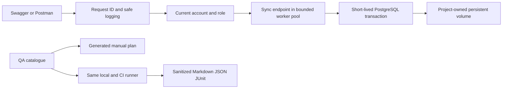

# 🏗️ **Architecture and persistence**

Foundation is a reusable **single-process Python API** with PostgreSQL managed by Compose. The API runs in the virtual environment on the host; Compose runs only PostgreSQL. There is no Ouroboros application or production deployment automation.

| Component | Responsibility / ownership |
| --- | --- |
| `start.py` | Stage-based orchestration, master authentication, migrations, first-administrator recovery, serving and independent cleanup |
| `app/config.py` | Root-relative JSON validation and atomic non-secret preference persistence |
| `app/credentials.py`, `console.py` | Independent database/master selection, masked terminal input, protected initialization files and compatible console formatting |
| `app/infrastructure.py`, `database.py` | Explicit workspace/project ownership, safe Compose subprocesses, database provisioning and bounded short-lived connections |
| `app/migrate.py`, `sql/migrations/` | Advisory-locked, transactional, checksummed version tracking; applied SQL is immutable |
| `app/main.py` | FastAPI factory/lifespan, request context, safe validation/errors and outcome logging |
| `app/auth.py`, `api_credentials.py`, `api_users.py` | Argon2id login, signed database-bound JWTs, current-role authorization, explicit first-admin recovery and serialized role changes |
| `app/endpoints/`, `schemas/`, `pagination.py` | Public/protected contracts, strict inputs, public user output and shared bounded collection pagination |
| `app/database_test.py`, `sql/queries/` | Parameterized SQL; SQL LIMIT/OFFSET and count share one statement snapshot |
| `app/logger.py`, `log_safety.py`, `request_context.py`, `cleanup.py` | UTF-8 per-execution logs, redaction/bounds, ContextVar isolation and independent resource closure |
| `qa/scenarios.json`, `scripts/run_checks.py` | Single scenario identity source, mapped checks, prerequisites and sanitized local/CI reports |

## 🗃️ **Tables and migrations**

| Migration / table | Persisted data |
| --- | --- |
| `001_create_test.sql` / `public.test` | Generated BIGINT id, unchanged non-null TEXT value |
| `002_create_api_users.sql` / `public.api_users` | Generated id, unique username, Argon2id hash, automatic TIMESTAMPTZ created_at, is_active and explicit test scopes |
| `003_add_api_user_role.sql` | Adds role with standard default and administrator/standard CHECK; no silent promotion |
| `004_add_credential_version.sql` | Adds per-account BIGINT credential_version default 1, positive CHECK; preserves existing hashes/data |
| `public.foundation_migrations` | Applied file name, SHA-256 checksum and timestamp |

The caller owns each database transaction. Each operation gets its own connection; the provider bounds simultaneous connections and wait time. Pagination returns only the SQL-bounded page to Python, with an unpaged count from the same statement. Multiple HTTP page requests can see different later commits.

Bootstrap, administrative membership writes and administrator password resets share transaction advisory lock **719230818**, distinct from migration lock **719230817**. API writes recheck the actor under the lock and lock affected rows before counting active administrators. Resets also recheck the actor's credential version, then lock the target and commit its hash/version together. Self-service locks only its own row; it never acquires the membership lock, avoiding inverted lock order. Direct master SQL must uphold that invariant itself. Authenticated API accounts never reuse PostgreSQL master authentication.

## 🔐 **Secrets and lifecycle**

Configuration stores token issuer/audience/lifetime and last_api_username, never passwords/hashes/tokens. API hashes stay in PostgreSQL. Protected ignored `.secrets/postgres_password` is a **plaintext initialization file**, not encrypted storage; `.secrets/jwt_signing_key` is a persistent signing key. Never include either in QA reports. Python releases references on shutdown but does not guarantee erasure of immutable strings.

API shutdown leaves PostgreSQL running. Database stop/start retains the project volume. Migrations add schema without recreating earlier tables. Legacy hash import commits before removing local auth fields and refuses conflicting data. See [operations](OPERATIONS.md) for safe lifecycle commands and [developer rules](../NEXTGENERATION.md) for implementation conventions.

Self-service password replacement takes an account row lock, revalidates the caller's credential version/active state and current password, then commits a fresh Argon2id hash and incremented version together. JWT validation compares that version on every request. Password changes are independent between accounts and do not rotate the shared signing key. The whole password-change body is excluded from logging; only the post-commit audit user_id/request context is emitted.
