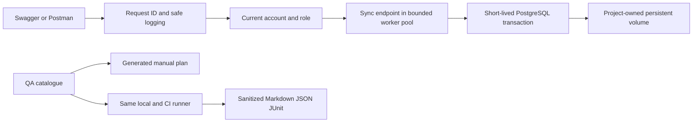

# 🏗️ **Architecture and persistence**

Ouroboros is an entertainment catalogue with an inherited **single-process Python API** and PostgreSQL managed by Compose. The API runs in the virtual environment on the host; Compose runs only PostgreSQL. Migration 005 implements the catalogue schema; migration 006 adds supervisor. See [the catalogue model](CATALOGUE.md) and [individual CRUD API](CATALOGUE_API.md). No production deployment automation is implemented.

| Component | Responsibility / ownership |
| --- | --- |
| `start.py` | Stage-based orchestration, master authentication, migrations, first-administrator recovery, serving and independent cleanup |
| `app/config.py` | Root-relative JSON validation and atomic non-secret preference persistence |
| `app/credentials.py`, `console.py` | Independent database/master selection, masked terminal input, protected initialization files and compatible console formatting |
| `app/infrastructure.py`, `database.py` | Explicit workspace/project ownership, safe Compose subprocesses, database provisioning and bounded short-lived connections |
| `app/migrate.py`, `sql/migrations/` | Advisory-locked, transactional, checksummed version tracking; applied SQL is immutable |
| `app/main.py` | FastAPI factory/lifespan, request context, safe validation/errors and outcome logging |
| `app/auth.py`, `api_credentials.py`, `api_users.py` | Argon2id login, signed database-bound JWTs, current-role authorization, explicit first-admin recovery and serialized role changes |
| `app/endpoints/`, `schemas/`, `pagination.py` | Public/protected contracts, strict inputs, public user output and shared bounded collection pagination |
| `app/database_test.py`, `sql/queries/` | Parameterized SQL; SQL LIMIT/OFFSET and count share one statement snapshot |
| `app/schemas/catalogue.py`, `app/endpoints/catalogue.py` | Eleven fixed resource contracts, named schemas, explicit enum query models and seven route forms each |
| `app/catalogue_repository.py`, `collection_queries.py`, `ordering.py` | Locked partial updates, transactional role/version revalidation, safe constraint errors, whitelisted SQL and consistent snapshots |
| `app/logger.py`, `log_safety.py`, `request_context.py`, `cleanup.py` | UTF-8 per-execution logs, redaction/bounds, ContextVar isolation and independent resource closure |
| `qa/scenarios.json`, `scripts/run_checks.py` | Single scenario identity source, mapped checks, prerequisites and sanitized local/CI reports |

## 🗃️ **Tables and migrations**

| Migration / table | Persisted data |
| --- | --- |
| `001_create_test.sql` / `public.test` | Generated BIGINT id, unchanged non-null TEXT value |
| `002_create_api_users.sql` / `public.api_users` | Generated id, unique username, Argon2id hash, automatic TIMESTAMPTZ created_at, is_active and explicit test scopes |
| `003_add_api_user_role.sql` | Adds role with standard default and administrator/standard CHECK; no silent promotion |
| `004_add_credential_version.sql` | Adds per-account BIGINT credential_version default 1, positive CHECK; preserves existing hashes/data |
| `005_create_catalogue.sql` | Adds eleven empty catalogue tables, independent generated identities, fixed metadata, restrictive FKs and same-work integrity; see [catalogue model](CATALOGUE.md) |
| `006_add_supervisor_role.sql` | Extends the role CHECK without replacing accounts, hashes or existing records |
| `public.foundation_migrations` | Applied file name, SHA-256 checksum and timestamp |

The caller owns each database transaction. Each operation gets its own connection; the provider bounds simultaneous connections and wait time. Pagination returns only the SQL-bounded page to Python, with an unpaged count from the same statement. Multiple HTTP page requests can see different later commits.

Bootstrap, administrative membership writes and administrator password resets share transaction advisory lock **719230818**, distinct from migration lock **719230817**. API writes recheck the actor under the lock and lock affected rows before counting active administrators. Resets also recheck the actor's credential version, then lock the target and commit its hash/version together. Self-service locks only its own row; it never acquires the membership lock, avoiding inverted lock order. Direct master SQL must uphold that invariant itself. Authenticated API accounts never reuse PostgreSQL master authentication.

## 🔐 **Secrets and lifecycle**

Configuration stores token issuer/audience/lifetime and last_api_username, never passwords/hashes/tokens. API hashes stay in PostgreSQL. Protected ignored `.secrets/postgres_password` is a **plaintext initialization file**, not encrypted storage; `.secrets/jwt_signing_key` is a persistent signing key. Never include either in QA reports. Python releases references on shutdown but does not guarantee erasure of immutable strings.

API shutdown leaves PostgreSQL running. Database stop/start retains the project volume. Migrations add schema without recreating earlier tables. Legacy hash import commits before removing local auth fields and refuses conflicting data. See [operations](OPERATIONS.md) for safe lifecycle commands and [developer rules](../NEXTGENERATION.md) for implementation conventions.

Self-service password replacement takes an account row lock, revalidates the caller's credential version/active state and current password, then commits a fresh Argon2id hash and incremented version together. JWT validation compares that version on every request. Password changes are independent between accounts and do not rotate the shared signing key. The whole password-change body is excluded from logging; only the post-commit audit user_id/request context is emitted.

## 🧾 Audit, UTC dates and filtered bulk operations

`app/audit_middleware.py` owns entry/transport finalization; `audit_context.py` carries server facts across worker contexts; `audit_privacy.py` bounds/redacts capture; `audit_store.py` performs short independent transactions. Migration 008 triggers own transactional mutation evidence. `audit_repository.py` and the audit schemas/routes expose reads only. `app/errors.py` validates the versioned JSON error catalogue and centralizes safe envelopes. `app/datetimes.py` owns clocks, source context and display conversion. Bulk SQL uses materialized locked targets and count summaries, sharing GET predicates through `collection_queries.py`.

See [the phase contract guide](AUDIT_DATETIME_BULK.md) for migrations 007–008, exact columns, central audit transaction guarantees and outage/crash gaps, versioned error envelopes, UTC/source/display timezone rules, immutable creation dates, and administrator previews/confirmed filtered mutations. The current catalogue has 77 route forms plus two read-only audit routes. Supervisor has individual CRUD and audit reads; standard has neither; administrator alone bulk mutates. Historical creation dates/context stay NULL. No automatic audit retention or durable replay is provided.

For manual QA use owned disposable storage and fresh private accounts. Inspect Swagger controls, complete a GET-to-PUT round trip with original display, preview a filtered change, confirm it explicitly only in disposable storage, and query its X-Interaction-ID in api_audit_logs. Verify standardized codes/header/log/audit correspondence, whole token/password body omissions and restricted audit reads. Record actual UI/Postman JavaScript evidence separately. Never enable destructive examples against normal data.

## 🪜 Classification tiers and complete test CRUD

Migrations009–010 add independent classification tier positions and complete integer-ID test CRUD with shared creation dates, UTC presentation, strict filters and confirmed administrator bulk operations. See [the authoritative contracts](TIERS_AND_TEST_CRUD.md) for the one-time inspected backfill, atomic append/insert/move/delete behavior, bulk tier exception, scope matrix and restart instructions. Never reseed or replace the existing nine normal classifications. Destructive QA remains isolated; review measurements and findings are documented separately.

## First frontend and browser session boundary

frontend/ contains the Angular 22 strict TypeScript application, feature components, Signal Forms, DI session/API services, preserved styles and original SVGs. The production build under frontend/dist/browser is the only client implementation served by FastAPI. Node is required only for build/test. See [Angular architecture and deployment](ANGULAR.md). FastAPI serves public home/assets and protects /cadastros through current browser account checks. app/browser_sessions.py holds bounded opaque process-local sessions; app/endpoints/browser.py exposes session/login/logout and page routes. Cookie mutations use the same require_scopes and existing catalogue repository/audit transactions as bearer requests. No domain tables or second CRUD layer are added. [Detailed contracts](FRONTEND.md) cover CSRF, privacy, explicit loopback HTTP and production HTTPS requirements.
