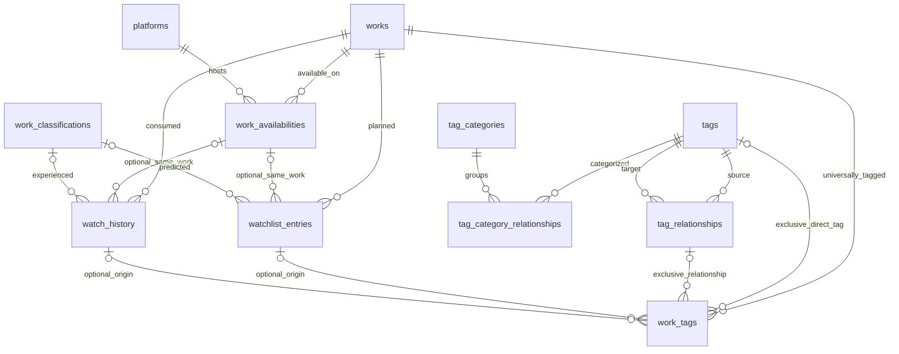

# 🐍 **Ouroboros catalogue — database phase one**

Ouroboros records entertainment consumption across books, films, series, and other media. A **work** has platform availabilities, watchlist entries, consumption experiences, and universal tags. Migration `005_create_catalogue.sql` adds the eleven tables below, with **no catalogue seed records**. The inherited test table, API users, and checksummed `foundation_migrations` tracking table remain separate. Foundation migrations 001–004 are unchanged.

## 🔑 **Common metadata on every catalogue table**

For each table named `<table>`:

| Column | Behavior |
| --- | --- |
| `id_<table>` | Permanent TEXT primary key, generated and stored by PostgreSQL |
| `sequence_<table>` | Positive BIGINT, independent `GENERATED ALWAYS AS IDENTITY` sequence |
| `prefix_<table>` | Required fixed TEXT with database default and CHECK |
| `fantasy_name_<table>` | Required fixed friendly table name, stored on every row with default and CHECK |

IDs concatenate the prefix and **at least seven decimal digits**: `WK0000001`, `TG0000001`, `AV0000001`. Padding uses `lpad(sequence::text, greatest(7, length(sequence::text)), '0')`: `WK9999999` is followed by `WK10000000`, without truncation or wrap. Sequences allocate independently; gaps are allowed and deleted values are not reassigned during normal inserts. Never reset sequences on a real database. Generated IDs cannot be supplied or assigned; an UPDATE trigger also rejects changes to their sequence, prefix, and fantasy name. As with all database constraints, privileged schema changes are outside these ordinary data-operation guarantees.

**Fantasy names describe tables**, such as `Obras`. **Display names describe individual records**, such as a tag's `Romance 💕`. The latter support Unicode, spaces, accents, emojis, and symbols and may change without changing the permanent ID. Technical tag/category/classification names are lowercase ASCII snake_case, starting with a letter, with digits allowed in segments. They are not given unapproved uniqueness constraints.

## 🗂️ **Exact tables and domain columns**

All tables include the four metadata columns above. `?` means nullable; other columns are required. TEXT fields have no artificial length limit except platform_url (2083 characters). FKs reference the matching permanent TEXT IDs.

| Table | Prefix | Fixed fantasy name | Additional columns |
| --- | --- | --- | --- |
| `works` | WK | Obras | `title TEXT`, `title_language TEXT`, `synopsis TEXT?` |
| `platforms` | PL | Plataformas | `platform_name TEXT`, `platform_is_paid BOOLEAN`, `platform_is_episodes BOOLEAN`, `platform_is_duration_time BOOLEAN`, `platform_access_types TEXT[] DEFAULT '{}'`, `platform_url TEXT?`, `price_amount NUMERIC?`, `price_currency TEXT?` |
| `work_availabilities` | AV | Disponibilidade de obras por plataformas | `id_works FK`, `id_platforms FK`, `duration_minutes NUMERIC?`, `episode_quantity BIGINT?`, `publisher_profile TEXT?`, `url TEXT?` |
| `tags` | TG | Tags | `tag_name TEXT`, `display_name_tags TEXT`, `description_tags TEXT?` |
| `tag_categories` | TC | Categorias de tags | `tag_category_name TEXT`, `display_name_tag_categories TEXT`, `description_tag_categories TEXT?` |
| `tag_category_relationships` | CR | Vínculos entre tags e categorias | `id_tags FK`, `id_tag_categories FK` |
| `tag_relationships` | TR | Relacionamentos entre tags | `id_tags_source FK`, `id_tags_target FK` |
| `work_tags` | WT | Vínculos entre obras e tags | `id_works FK`, `id_tags FK?`, `id_tag_relationships FK?`, `id_watchlist_entries FK?`, `id_watch_history FK?` |
| `work_classifications` | WC | Classificações de obras | `work_classification_name TEXT`, `display_name_work_classifications TEXT`, `description_work_classifications TEXT?` |
| `watchlist_entries` | WS | To Be Watched | `id_works FK`, `id_work_availabilities FK?`, `id_work_classifications_predicted FK?`, `observations TEXT?`, `added_at TIMESTAMPTZ DEFAULT CURRENT_TIMESTAMP` |
| `watch_history` | WH | Watched | `id_works FK`, `id_work_availabilities FK?`, `id_work_classifications FK?`, `observations TEXT?`, `watched_at TIMESTAMPTZ?` |

Titles retain supplied spelling and language, and duplicate titles are allowed. `title_language` records a language code such as `es`, `en`, or `pt`; no language-reference table or invented closed list is added. **Synopsis content must be English**. This is a content rule; SQL does not pretend to detect language. Media types can be represented by tags for now; there is no work-type field/table.

Platform episode/duration indicators are independent expectations; both may be true or false. They do not require availability fields. Optional duration and episode quantity may coexist and must be positive when supplied. There is no episode-duration field. Prices use exact NUMERIC, must be nonnegative and finite, and belong only to platforms. **A missing price does not mean free**: `platform_is_paid` supplies that status. Availability-specific prices or free overrides are not modeled. Currency and language codes are text without unapproved reference tables.

## 🔗 **Relationships and integrity**



- Tags may have zero, one, or multiple categories; categories may contain many tags. Only duplicate tag/category pairs are prohibited.
- Tag relationships are **ordered reusable associations**, for example `support_without_dependence` → `romantic_partner` or `antagonist`. The inverse is distinct. Creation does not apply the association to a work, and neither relationship table has a description field.
- Each `work_tags` row selects **exactly one** direct tag or reusable relationship. It may record one watchlist origin, one history origin, or neither, never both. Tags remain universal to the work regardless of that origin. Origin is provenance, **not a complete tag-change history**.
- Composite foreign keys enforce that availability and provenance belong to the same work, including on UPDATE. Supporting `(id_works, id_...)` UNIQUE keys identify existing records for these FKs; they do not prohibit repeated experiences.
- Repeated availabilities, watchlist entries, consumption experiences, and tag associations are allowed. Independent history rows can have different classifications and observations. Historical completion dates stay NULL when unknown; startup never invents them. `watch_history` also covers books and other media.
- Every FK uses **ON DELETE RESTRICT**. Referenced works, platforms, classifications, tags, availabilities, and origins cannot be deleted while dependents exist. There is no cascading deletion of consumption history. Deliberate deletion of an unreferenced row is possible; this is not an audit-history implementation.
- Foreign-key/relationship lookup indexes complement primary/unique indexes without duplicating their leading columns. Retrieve relationships with joins; works contain no ID arrays.

## 🏆 **Classification vocabulary — documentation only**

The approved order is listed below. **No classification records are seeded**, and no rank/display-order column has been approved. ID sequence is never classification rank.

1. 🏆 PQP
2. MEU DEUS FAVORITA
3. CARALHO AMEI
4. TÃO RIDÍCULO QUE EU AMEI
5. AMEI DE BOA
6. BOBINHA DELÍCIA
7. DEU PRO GASTO
8. 🤬 QUE ÓDIO, CRIATURA!
9. NUNCA MAIS

## 🧱 **Infrastructure and launch**

Ouroboros owns Compose identity `ouroboros`, volume `ouroboros_postgres_data`, its own workspace binding/ownership receipt, prompted database (example `ouroboros`), fresh API users, protected initialization password file, and signing key. Foundation retains project `foundation`, volume `foundation_postgres_data`, files, database and credentials. Never copy Foundation runtime configuration/secrets or adopt its volume. The inherited startup guard verifies workspace ownership before reuse; subsequent startups preserve records and applied checksums.

Run from an interactive PowerShell terminal; enter database/master/API credentials only through the existing masked prompts:

```powershell
Set-Location -LiteralPath C:\Dev\Ouroboros
.\.venv\Scripts\python.exe start.py
```

Swagger: **http://localhost:6969/docs**. PostgreSQL: **127.0.0.1:6669**, internal port **5432**. Database/master names remain prompted, not hardcoded. Ctrl+C stops the API while leaving PostgreSQL running. Normal startup creates no catalogue records; first-administrator enrollment remains allowed.

## 🧪 **Verification and review**

Run `.\.venv\Scripts\python.exe scripts/run_checks.py`. It uses disposable UUID Compose projects, random credentials and ephemeral ports; it never reads normal configuration/secrets. Catalogue scenarios **13.1–13.7** in the [QA plan](QA_TEST_PLAN.md#scenario-13-1) map to `tests/test_catalogue.py`. They exercise real PostgreSQL, boundary IDs, metadata, fields, FKs, repetitions, provenance, migration replay and stop/start persistence. All inherited authentication, roles, password-change/reset, health/test and logging regression checks remain in the same runner. Schema/HTTP checks do not establish Swagger clicks, Postman import/sandbox, terminal appearance or hosted CI execution.

Review `feat/initial-tables` before any merge into `main`. No commit, push or merge is part of this phase request. The canonical collection is `postman/Ouroboros.postman_collection.json`; its complete README JSON must stay synchronized. Historical private Postman YAML/metadata remain untouched. [FINAL_REVIEW.md](FINAL_REVIEW.md) contains historical Foundation evidence, not current phase approval.

## 🔮 **Pending design and future capabilities**

Individual [catalogue CRUD APIs](CATALOGUE_API.md), scalar filters and configurable ordering are implemented. Faceted filtering, relationship-aware filters and AI-assisted preference analysis remain planned. No AI, frontend or advanced search is implemented. Classification display order, PQP review stages, scheduled reassessments, availability-specific pricing/free overrides, tag-removal history, soft deletion and audit-event-table design remain pending. Destructive API operations now have safe application audit logs; these do not constitute a tag-change history. No prediction-history table or watching/in-progress state is implemented.

## 🧾 Audit, UTC dates and filtered bulk operations

See [the phase contract guide](AUDIT_DATETIME_BULK.md) for migrations 007–008, exact columns, central audit transaction guarantees and outage/crash gaps, versioned error envelopes, UTC/source/display timezone rules, immutable creation dates, and administrator previews/confirmed filtered mutations. The current catalogue has 77 route forms plus two read-only audit routes. Supervisor has individual CRUD and audit reads; standard has neither; administrator alone bulk mutates. Historical creation dates/context stay NULL. No automatic audit retention or durable replay is provided.

For manual QA use owned disposable storage and fresh private accounts. Inspect Swagger controls, complete a GET-to-PUT round trip with original display, preview a filtered change, confirm it explicitly only in disposable storage, and query its X-Interaction-ID in api_audit_logs. Verify standardized codes/header/log/audit correspondence, whole token/password body omissions and restricted audit reads. Record actual UI/Postman JavaScript evidence separately. Never enable destructive examples against normal data.

## 🪜 Classification tiers and complete test CRUD

Migrations009–010 add independent classification tier positions and complete integer-ID test CRUD with shared creation dates, UTC presentation, strict filters and confirmed administrator bulk operations. See [the authoritative contracts](TIERS_AND_TEST_CRUD.md) for the one-time inspected backfill, atomic append/insert/move/delete behavior, bulk tier exception, scope matrix and restart instructions. Never reseed or replace the existing nine normal classifications. Destructive QA remains isolated; review measurements and findings are documented separately.
