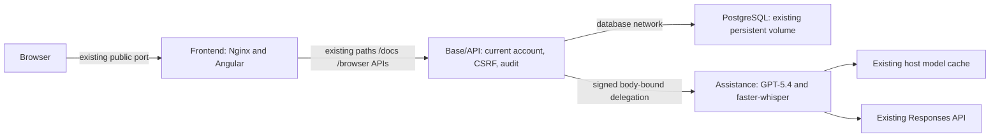

# Four-module container runtime

This guide supersedes the former host-venv application startup instructions. Business contracts, account permissions, migrations and existing data are unchanged.

## Layout and configuration

| Module | Runtime | Private/local configuration | Versioned example |
| --- | --- | --- | --- |
| Database | Existing `postgres` service, PostgreSQL 17.11 | `modules/database/.config.json` | `modules/database/config.example.json` |
| Base/API | `modules/base`, Python 3.12, FastAPI | `modules/base/config/.config.json` | `modules/base/config.example.json` |
| Frontend | Existing `frontend/`, `modules/frontend` Nginx image | `modules/frontend/.config.json` | `modules/frontend/config.example.json` |
| Assistance | `modules/assistance`, Python 3.12, faster-whisper and existing GPT-5.4 provider | `modules/assistance/.config.json` | `modules/assistance/config.example.json` |

`start.py` delegates to the standard-library-only `modules/orchestration.py`. `.orchestration.json` holds the Compose project, existing public address/port, startup deadline, configurable internal API/assistance/database addresses and host model-cache location; `.orchestration.example.json` documents its shape. The approved defaults remain HTTP 6969 and loopback PostgreSQL 6669. No assistance or separate API port is published in the four-service mode.

On first use, existing `.app.config`, `.ai.config` and public frontend values are adopted into the module-local files. Original files are preserved; existing module files are never overwritten on subsequent starts. After adoption edit the module files, not the legacy files. A fresh installation can initialize from the module examples. Local module configurations and orchestration preferences are ignored by Git; examples contain no credentials.

Database configuration retains PostgreSQL initialization preferences and its existing published port. Base/API owns the selected database/user, auth, browser origin, logging, timezones and business/API limits. The container substitutes only the internal connection address (`postgres:5432`); host ports are not used between containers. Initialization preferences never rotate roles/passwords in an existing volume.

Assistance configuration owns transcription model/device/compute type, languages, native-window size, audio/text budgets, recording duration, concurrency and timeouts. The `form_assistant` block owns the existing provider processing budgets; its model must remain exactly `gpt-5.4`. Defaults preserve the previous prompts, model and inference parameters. The host cache path is orchestration storage metadata; the assistance process always sees that bind mount as `/models`.

The public frontend JSON controls both names, greetings, image paths and independent color groups. Angular loads `/frontend/runtime-config.json` before bootstrap. The frontend entrypoint validates this JSON and generates external `/frontend/assistant-theme.css`, preserving strict CSP. Edit `modules/frontend/.config.json`, then restart the frontend through `python start.py`; no Angular rebuild is needed for those presentation changes. Images are mounted from `frontend/public/images`. Public configuration accepts only presentation keys and same-origin `/frontend/` image paths, never credentials or service addresses. Node builds Angular and runs a short CSS-generation command at container startup; Nginx is the serving process.

## Startup and credentials

From `C:\Dev\Ouroboros` with Docker Desktop running in Linux-container mode:

```powershell
python start.py
```

Any installed compatible launcher Python can run this command; the application and native speech dependencies run in Python 3.12 images. Existing `.venv` and `.venv-speech` remain intact. `start-speech.cmd` is only a compatibility wrapper around the same container launcher.

The launcher validates Compose, uses Docker build caching, verifies the existing infrastructure ownership receipt, starts/reuses PostgreSQL, then runs an interactive bootstrap inside the API image. Enter the existing master credentials yourself. This bootstrap authenticates before checking exact migration checksums and recovering API administration through the existing flow. Credentials are never passed in process arguments or environment variables. The original protected `.secrets/postgres_password` remains the runtime secret; if the authenticated password and stored runtime secret differ, startup stops for explicit reconciliation rather than overwriting a secret or changing a role.

API and frontend readiness are required. Assistance is started and checked separately: its failure is reported but does not block the catalogue. No migration is added or rewritten by this modularization. No `down --volumes`, data reset, normal seed, automatic alternate port or unknown-process termination is performed.

`python start.py --check` validates module adoption and Compose without starting services or authenticating to PostgreSQL. `--build-only` builds the application images without database access. `--api-only` uses the same API image directly on the existing public port, without starting frontend or assistance. Use it when that port is free; stop an existing owned listener explicitly before changing modes. The launcher never terminates it automatically. In direct mode `/docs`, `/health`, bearer tokens and the existing API paths remain available; no frontend assets are required.

Compose services remain running after the launcher exits. Re-running the same command reloads application services/configuration while reusing persistent data/cache and cached build layers. PostgreSQL is reused unless its own container configuration changes. An unchanged Docker build does not rerun Angular compilation. Container logs are available through the owning project's Docker Desktop; API application logs remain under `logs/`. Bootstrap and API have separate execution logs. Do not print Compose environment/secret inspection output in reports.

## Communication and authority



There are exactly four production services. The database network is internal and shared only by API/PostgreSQL. PostgreSQL also attaches alone to a separate `database_host` bridge so Docker can retain the original loopback port 6669; an internal-only attachment suppresses effective port publication. No other module joins that host-access bridge. The assistance network contains only API/assistance; the frontend network contains only frontend/API. Assistance has no PostgreSQL network attachment, driver requirement, database password, JWT signing secret or administrative credentials. Its root filesystem is read-only, with ephemeral `/tmp` and a persistent model-cache mount.

Frontend proxying preserves Host, cookies, Origin and CSRF headers. Client-address forwarding is trusted only when the immediate source matches the configured frontend service's resolved address; arbitrary browser forwarding headers are not trusted. Protected page navigation uses the existing account/role rule through a private Nginx auth subrequest. HTTPS installations must retain their approved HTTPS origin/termination; this stage adds no TLS endpoint or new published port.

Every assistance call first passes the existing API account, current-role and CSRF/bearer checks. The API issues an HMAC delegation bound to the operation, body digest, authorized subject, lifetime and nonce. Assistance verifies it and rejects replay; user-supplied IDs/roles are never sufficient. The signing key is a separate protected `.secrets/assistance_service_key`, unrelated to user JWTs. The existing root `.env` is mounted only into assistance for `OPENAI_API_KEY`, never copied into images or public assets. The existing `.secrets` directory remains API-private. Runtime processes consume these protected files without bypassing the interactive normal migration/bootstrap authentication.

Audio, transcripts and conversation bodies remain omitted from API execution logs and audit bodies. Assistance has no business-write endpoints or database audit credentials; business operations still use the existing API. Audio remains in bounded memory, is cleared after requests and is never written to persistent storage.

This design follows the separation and per-request authorization guidance in the [OWASP REST Security](https://cheatsheetseries.owasp.org/cheatsheets/REST_Security_Cheat_Sheet.html), [Authorization](https://cheatsheetseries.owasp.org/cheatsheets/Authorization_Cheat_Sheet.html) and [Logging](https://cheatsheetseries.owasp.org/cheatsheets/Logging_Cheat_Sheet.html) cheat sheets; it is not a blanket ASVS compliance claim. Internal HTTP is confined to local Compose bridges, not a distributed deployment security design.

## Dependencies and persistent storage

- Base/API installs `requirements.txt`; it does not install or execute faster-whisper/CTranslate2/PyAV models.
- Assistance installs `modules/assistance/requirements.txt` and `requirements-transcription.txt`; shared Pydantic form contracts are reused without account/database implementations.
- Frontend uses `npm ci` with the existing lockfile in a Node build stage and serves static assets through Nginx.
- PostgreSQL retains the exact existing Compose identity and `<project>_postgres_data` volume. Model files reuse the configured existing host directory; restarts do not redownload a cached model.
- Configuration, original protected secrets, provider `.env`, frontend images and API logs remain external to images. `.dockerignore` excludes private files, local environments, node_modules, build caches and QA scratch files.

API browser sessions and assistance replay/capacity state remain process-local, as before. Separate service sizing is possible; multiple API replicas/shared sessions or distributed replay coordination are future work, not implemented here.

## Verification

Use built images with `python scripts/verify_modules.py` from a declared QA environment. It creates a randomly named owned project with PostgreSQL in tmpfs, disposable accounts/secrets, no published ports, and removes only its own containers/network afterward. It never queries the normal database or deletes any named volume. `--audio <disposable.wav>` also exercises real transcription; `--live-assistant` makes one live GPT-5.4 request using the configured provider file mounted only into disposable assistance (with normal provider usage cost); `--publish` optionally uses only approved port 6969 when free. Never supply personal recordings.

See [the module QA record](MODULES_QA.md) for actual executed checks and remaining manual/normal-installation steps. Unit checks and internal HTTP checks do not establish browser rendering, physical microphone behavior or normal-database authentication.
