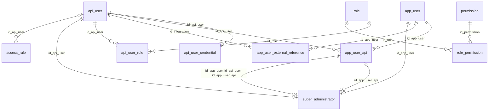
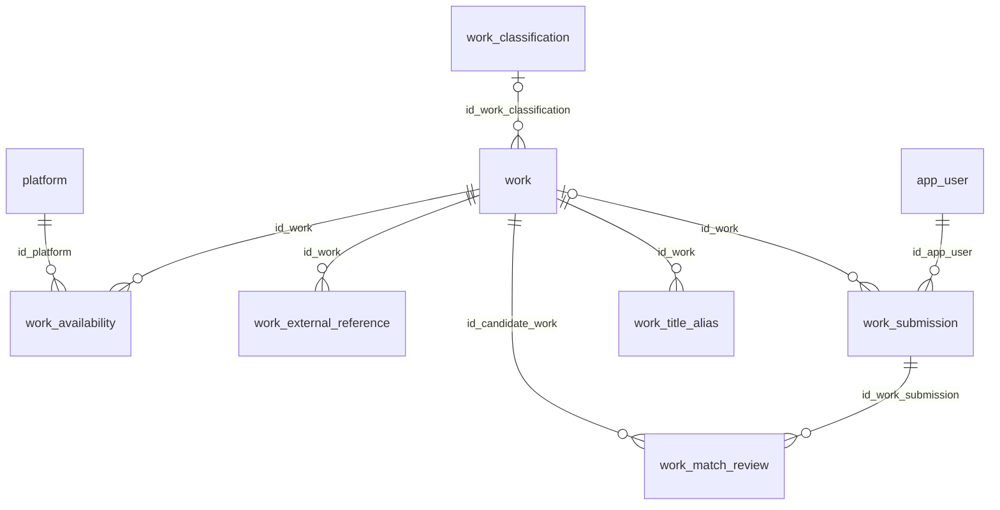
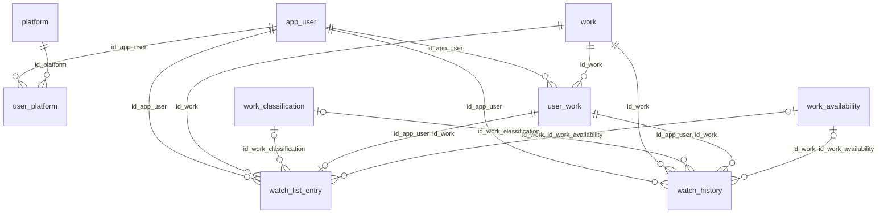
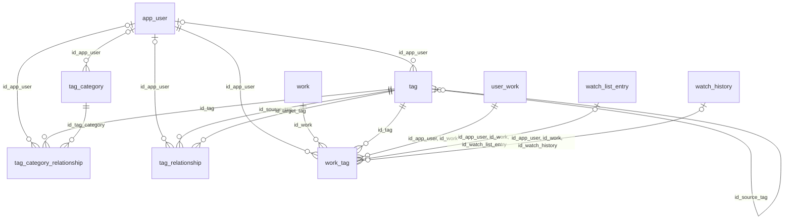
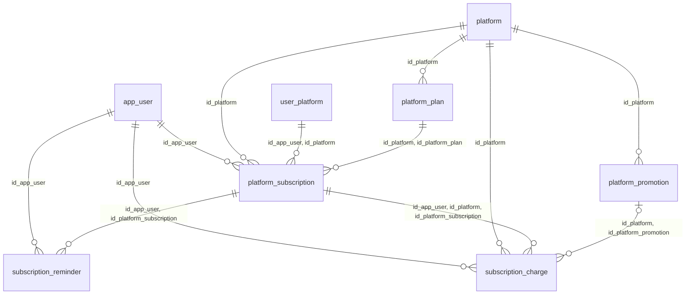
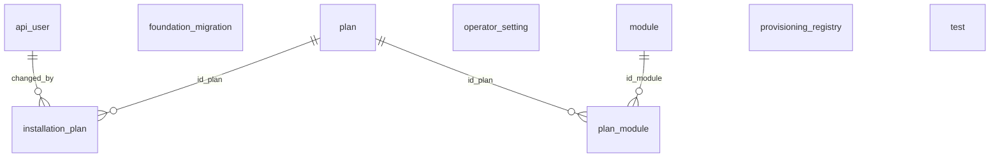
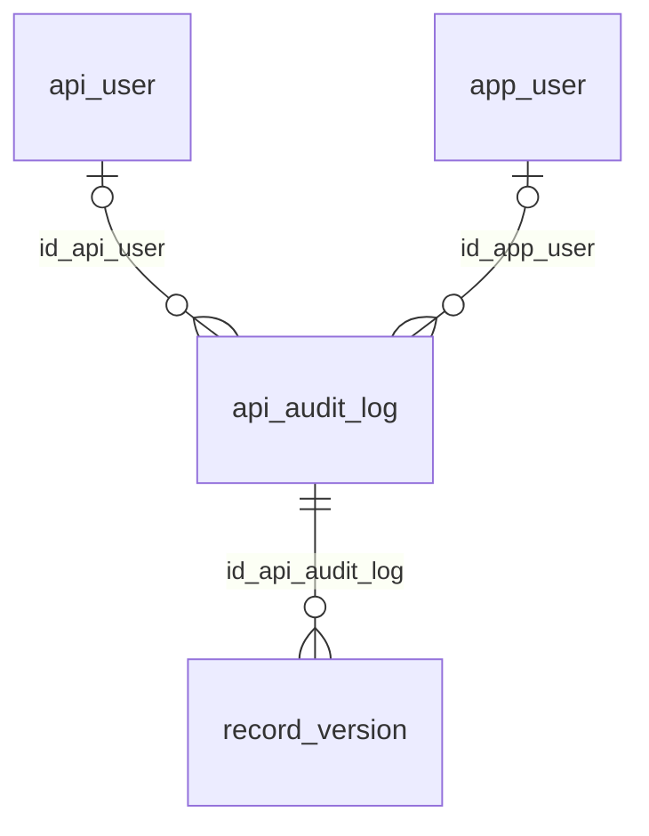

# Database module — installation and schema reference

`start.py --database-only` starts only PostgreSQL and provisions the new schema.
The default `start.py` and `--with-api` start PostgreSQL plus the HTTPS API in the
single Compose project `ouroboros`. Fresh bootstrap automatically activates
Basic (Plan 1: Database + API Integration). Frontend and Assistance remain modeled
as additional modules. Their services are outside this Basic deployment.

## Install and start

From the project directory in PowerShell:

```powershell
.\.venv\Scripts\python.exe -m pip install -r modules/database/requirements.txt
.\.venv\Scripts\python.exe start.py --database-only --check
.\.venv\Scripts\python.exe start.py --database-only
```

Python 3.10+ and Docker Compose with `include` support are required. Paths resolve relative to the repository,
independently of the terminal working directory. `--check` creates missing local
configuration from examples, validates it, and makes no Docker/PostgreSQL changes.
Both local files are ignored by Git; their commented examples are versioned.
Unknown fields, duplicate keys (at every depth), wrong types, nonfinite JSON
numbers, naming collisions and invalid prefixes fail closed. JSONC supports real
line and block comments, not trailing commas. Comments do not affect structural identity.

Startup refuses occupied ports and never stops unrelated services or selects a
different port. The owner explicitly authorized a fresh reset on 2026-11-13.
Docker project/workspace labels, mounts, volume consumers and network endpoints
were inspected before removing the old Ouroboros containers, two PostgreSQL
volumes and six networks. The separate Foundation project was preserved.

`compose.basic.yaml` includes `modules/database/compose.yaml` and `modules/api/compose.yaml`.
The project is `ouroboros`, with service `postgresql` and persistent volume
`ouroboros_installation_v1`. The API profile adds service `api` on the same
internal network. SQL administration stays at 127.0.0.1:6669. API runtime uses
`postgresql:5432`. No volume deletion or global prune exists in startup.
See [API.md](../api/API.md) for HTTPS preparation and the combined start command.

First start requests the PostgreSQL Master Password, then the App User username,
App User display name, linked API User username and separate App Password.
Use the App User username and App Password in Swagger's App User section; the
linked API User username is accepted with the same App Password. OAuth2 Client
Credentials uses a separate provisioned Client ID and Client Secret.
Database/API prompts and messages are in English. Both human passwords
require 8-16 characters with uppercase, lowercase, digit and special character;
whitespace/control characters are rejected. All password prompts, including SQL
master and application password confirmations, show one `*` per typed character.
Backspace removes the last character and its asterisk; Enter confirms the input.
The real password is never displayed or logged. If masking is unavailable,
password entry remains hidden; a terminal that cannot disable echo is rejected.
This requested human policy differs from OWASP's recommendation to allow longer
passwords and does not apply to generated client credentials. No default
password exists. Do not put passwords in commands, JSONC or documentation.

The SQL secret is `.secrets/database_sql_password`, separate from the historical
secret and application hash. Its directory and file receive a protected current
Windows-user DACL (POSIX 0700/0600). It is an administrative plaintext file secret,
not encrypted storage; Docker administrators and the OS account are trusted.
Startup fails if protection fails. The application password exists only during
enrollment and as an Argon2id hash in `api_user_credential`. It is never written
to the SQL secret. Secrets are never command arguments or Docker environment values.
Python cannot guarantee erasure of immutable password strings from process memory.

Schema creation is one transaction. Enrollment (person, API identity, credential,
membership, reserved singleton, modules and initial plan) is another single
transaction under the same installation advisory lock. Interrupting either can be
resumed by the same command without partial duplicate accounts or entitlements.
Subsequent starts reuse the existing operator without enrollment or user switching.
An interrupted first start may leave the schema ready for terminal enrollment.

Restart with the same start command. PostgreSQL remains running when the command
finishes. Operational address/health/timeout values take effect on the next start;
Compose recreates the owned container when its effective configuration changes.
The SQL master username is an initdb identity: changing it does not rename or
create a SQL role and fails authentication until restored or deliberately
administered outside startup. Startup never rotates the master password.

## SQL client administration

Default DBeaver/pgAdmin PostgreSQL connection:

| Setting | Value |
| --- | --- |
| Host | `127.0.0.1` |
| Published port | `6669` |
| Database | `ouroboros` (from provisioning) |
| Application schema | `ouroboros` (from provisioning) |
| SQL user | `ouroboros_master` (from operational config) |
| Password | The SQL master password entered interactively |
| Container-internal port | `5432` |

An empty published address means `127.0.0.1`; only loopback IPs are accepted.
The port must remain 6669. SQL master administration is distinct from application
super administration. SaaS users/integrations receive no SQL credentials.
Database-only creates no tenant SQL logins. The separate API module implements the HTTP authentication flows described in [API.md](../api/API.md).

## Structural identity and naming

The provisioning registry stores canonical JSON plus SHA-256 of all validated
structural values and the full logical-to-physical table mapping. On an existing
installation startup compares these values and refuses differences before applying
SQL. Existing running services are checked before Compose recreation. Comment or
whitespace changes do not matter. No table rename, ID regeneration or schema
upgrade occurs when editing JSONC. Restore the applied configuration on mismatch.
Database-name changes are rejected against the existing container's initdb identity.
Schema changes are rejected against the registry in the existing schema.

Before any volume exists, an interactive prefix conflict lists logical tables and
allows correction of one unreserved table at a time. Saving changes only the value
span, retaining comments. Revalidation repeats until all prefixes are unique.
Noninteractive conflicts and conflicts after a volume exists fail without repair.
Confirmed AU/US/QA/FM prefixes cannot be reassigned. Prefixes contain 2-8 uppercase
ASCII letters. All names are validated, length-bounded ASCII SQL identifiers;
physical collisions are rejected, including collisions with fixed technical names.

Each vocabulary group has a singular `name`. Derived names substitute work,
platform and tag tokens, and activity in `watch_list_entry`/`watch_history`.
For example work=book, activity=read produces book, book_availability,
book_classification, book_tag, read_list_entry and read_history. There is no
activity table or activity prefix. Technical names remain fixed. Prefix keys
are stable logical names even under alternate vocabulary.

## Migrations and privileges

Historical `modules/database/sql/migrations/001` through `011` remain exact immutable
bytes and are NOT replayed in this track. This is an explicit new-installation
baseline `database-v1/001`, generated from `modules/database/model.py` and the fixed
functions in `modules/database/provision.py`. Its registry version is unique independently
of its friendly ID. The checksum covers the raw bytes of both implementation
files and generated table SQL; do not edit these files after deployment without
designing a new migration track. This delivery provides no upgrade from the old
public schema. Unregistered nonempty databases are rejected.

The initdb master is a trusted PostgreSQL administrator. `ouroboros_owner`
(NOLOGIN) owns the application schema, tables, sequences and functions; only the
master receives its membership. `ouroboros_runtime` is NOLOGIN, non-superuser,
cannot create databases/roles, and is not a member of the migration role. It is a
capability role for the trusted API broker, not a customer login.
Database-only creates no runtime login. Combined startup adds the restricted `ouroboros_api_login` through the API migrations. Public database privileges
and public-schema CREATE are revoked; no app-schema CREATE is granted to runtime.
The master's database search_path is pg_catalog then the app schema. Startup and
functions use qualified references with a pg_catalog-only controlled search_path.
Functions have no PUBLIC execute defaults. Runtime receives explicit DML only on
ordinary business tables, SELECT on noncredential tables and sequence USAGE.
No ordinary credential hash access or DML on reserved plan/installation/audit state
is granted. Runtime cannot update/delete audit or version evidence, migrate,
disable triggers or grant itself owner privileges.

`super_administrator` is a protected singleton referencing the person's exact
API membership. A common role named super_administrator and common permission on
installation_plan are prohibited. Runtime cannot write the singleton or plan
tables. The only granted plan mutation function, `change_plan(text)`, rechecks
the active reserved holder, person and current link with row locks in the same
transaction, and verifies the mandatory Database/API bundle. Plan 1 starts with
both mandatory modules; modules/frontend/assistance are optional module records.

The API authenticates before setting transaction-local
ouroboros.actor_api_user and optional ouroboros.actor_app_user. These settings are
trusted broker context, NOT a SQL-client authentication mechanism. Never grant
runtime membership to tenant-controlled SQL users. The database verifies current
actor existence/activity and current person membership when context is supplied;
trusted direct SQL administration may omit actor context. API authorization
and account-creation permission checks are enforced at the API capability boundary.
Allow/deny rules persist resource/action restrictions. The API capability layer
evaluates current permissions and deny precedence; standalone database schema
provisioning does not authenticate HTTP clients.

## Common columns, ownership and deletion

Every application table, including relationships and evidence, has:

| Column pattern | Type and rule |
| --- | --- |
| sequence_<physical_table> | BIGINT GENERATED ALWAYS AS IDENTITY, positive, unique, immutable |
| prefix_<physical_table> | TEXT NOT NULL, immutable by fixed CHECK |
| id_<physical_table> | Generated stored TEXT primary key: prefix + positive sequence, at least base_quantity_digits digits |
| created_at | TIMESTAMPTZ NOT NULL, server-generated UTC instant, immutable |
| created_at_timezone | TEXT NOT NULL DEFAULT UTC, immutable source context |

IDs grow past the configured width without truncation; they are never rebuilt
or reused by startup. Catalog tables marked below additionally have immutable
fantasy_name_<table> technical metadata, distinct from personal_name and display_name.
All FK deletions are RESTRICT; there are no cascading deletions. All uniqueness,
FK and CHECK expressions below are authoritative SQL and use physical names.
Columns without NOT NULL are nullable. Common metadata is omitted from the per-table
SQL fragments below, which list every other column and table constraint.

app_user owns personal links, history, subscriptions and personal tags/categories.
Ownership is immutable. Composite keys enforce same-owner/session/work/platform
references, including availability belonging to the recorded work. Tag triggers
permit reuse/copy of shared tags but reject other users' private tags and crossing
personal relationship graphs. Tag visibility and work-tag visibility are independent.
Classification is installation-shared with an independent positive unique tier;
new NULL-tier inserts append under the list lock. No normal classification is seeded.
Future reorder operations must retain membership/actor/list/record locks, deferred
uniqueness and audit evidence for every shift, as in the existing developer contract.
External person references are unique per integration API identity and external ID.
Person/API membership end dates retain prior links; only current duplicate pairs
are prohibited. Deleting memberships, changing their original API identity/start
or reopening an ended membership is prohibited by a history trigger.
api_user may exist without a person. There is no service-account
table or routine-wide master application credential.

Every business mutation emits an immutable api_audit_log event and a record_version
entry in the SAME transaction through mandatory security-definer triggers. Versions
reference the event, resource, record ID, operation and monotonic per-record version;
they intentionally contain no row snapshots. Audit stores technical actor, optional
person and transaction ID. No request bodies, SQL values, personal text, tokens,
passwords or hashes are captured. Thus no recursive sensitive-body redaction is
needed here: complete payload omission is the boundary. Evidence FK failure rolls
back business changes. Masters remain trusted and can alter the database; this is
not master-resistant tamper-proof storage or a blanket OWASP compliance claim.

Subscription charges snapshot amount, currency and paid access interval independently
of current plan/promotion price. Charge rows are append-only: updates/deletes are
rejected by the evidence trigger. Current subscription access_until is explicit.
Reminder records are schema only; no scheduler or sending exists. Watchlist counts
by platform are derived by joining entries to availability, without counters.
Submissions/matches and work verification state are persisted schema only; no
review automation or human-review UI is included.

Security design references consulted: [OWASP ASVS](https://owasp.org/projects/asvs),
[Authentication](https://cheatsheetseries.owasp.org/cheatsheets/Authentication_Cheat_Sheet.html),
[Authorization](https://cheatsheetseries.owasp.org/cheatsheets/Authorization_Cheat_Sheet.html),
[Password Storage](https://cheatsheetseries.owasp.org/cheatsheets/Password_Storage_Cheat_Sheet.html),
[Logging](https://cheatsheetseries.owasp.org/cheatsheets/Logging_Cheat_Sheet.html),
[Input Validation](https://cheatsheetseries.owasp.org/cheatsheets/Input_Validation_Cheat_Sheet.html),
[Error Handling](https://cheatsheetseries.owasp.org/cheatsheets/Error_Handling_Cheat_Sheet.html).

## Configuration examples

Root provisioning.example.jsonc:

```jsonc
{
  // Structural values are frozen after provisioning; comments are ignored.
  "format_version": 1,
  "naming_rules_version": 1,
  "database_name": "ouroboros",
  "schema": "ouroboros",
  // Singular vocabulary only; activity has no table or prefix.
  "vocabulary": {
    "work": {
      "name": "work"
    },
    "platform": {
      "name": "platform"
    },
    "tag": {
      "name": "tag"
    },
    "activity": {
      "name": "watch"
    }
  },
  "base_quantity_digits": 7,
  // Unique immutable uppercase prefixes indexed by logical table key.
  "prefixes": {
    "test": "QA",
    "foundation_migration": "FM",
    "provisioning_registry": "PR",
    "api_user": "AU",
    "api_user_credential": "AC",
    "app_user": "US",
    "app_user_api": "UA",
    "app_user_external_reference": "UR",
    "role": "RO",
    "permission": "PE",
    "api_user_role": "AR",
    "role_permission": "RP",
    "super_administrator": "SA",
    "plan": "PN",
    "module": "MD",
    "plan_module": "PM",
    "installation_plan": "IP",
    "operator_setting": "OS",
    "access_rule": "AX",
    "work": "WK",
    "platform": "PL",
    "work_availability": "AV",
    "work_classification": "WC",
    "work_title_alias": "TA",
    "work_external_reference": "WR",
    "user_work": "UW",
    "user_platform": "UP",
    "watch_list_entry": "WL",
    "watch_history": "WH",
    "work_submission": "SB",
    "work_match_review": "MR",
    "tag": "TG",
    "tag_category": "TC",
    "tag_category_relationship": "CR",
    "tag_relationship": "TR",
    "work_tag": "WT",
    "platform_plan": "PP",
    "platform_subscription": "PS",
    "subscription_charge": "SC",
    "platform_promotion": "PX",
    "subscription_reminder": "SR",
    "api_audit_log": "AL",
    "record_version": "RV"
  }
}
```

Database config.example.jsonc:

```jsonc
{
  // SQL administration is separate from the application super administrator.
  "master_user": "ouroboros_master",
  // Protected file reference only. Never put a password in JSONC.
  "secret_file": ".secrets/database_sql_password",
  // Empty means 127.0.0.1. Only loopback addresses are accepted.
  "published_address": "",
  "published_port": 6669,
  "startup_timeout_seconds": 120,
  // Effective Docker health check; internal PostgreSQL port is always 5432.
  "healthcheck": {
    "interval_seconds": 2,
    "timeout_seconds": 3,
    "retries": 30,
    "start_period_seconds": 5
  }
}

```

## Tables and columns

### test — QA

Installation-wide diagnostic records. Use disposable data for mutation QA.

Fixed technical name. Business state. All referenced records restrict deletion.

```sql
value TEXT NOT NULL
```

### foundation_migration — FM

Installation-owned registry of applied migration versions and exact checksums.

Fixed technical name. Protected runtime state; no ordinary DML. All referenced records restrict deletion.

```sql
version TEXT NOT NULL UNIQUE, checksum TEXT NOT NULL CHECK (checksum ~ '^[0-9a-f]{64}$')
```

### provisioning_registry — PR

Installation-owned singleton containing the frozen structural configuration and table mapping.

Fixed technical name. Protected runtime state; no ordinary DML. All referenced records restrict deletion.

```sql
singleton BOOLEAN NOT NULL DEFAULT true UNIQUE CHECK (singleton), structural_hash TEXT NOT NULL, structural_mapping JSONB NOT NULL
```

### api_user — AU

Technical authentication identity. An identity may exist without a person; username is unique.

Fixed technical name. Business state. All referenced records restrict deletion.

```sql
username TEXT NOT NULL UNIQUE, is_active BOOLEAN NOT NULL DEFAULT true, credential_version BIGINT NOT NULL DEFAULT 1 CHECK (credential_version > 0)
```

### api_user_credential — AC

Credential belonging to one API identity. Stores only Argon2id hashes, kind and revocation time; never a retrievable password.

Fixed technical name. Business state. All referenced records restrict deletion.

```sql
id_api_user TEXT NOT NULL REFERENCES "ouroboros"."api_user"(id_api_user) ON DELETE RESTRICT, credential_kind TEXT NOT NULL CHECK (credential_kind IN ('human_password','client_credentials')), secret_hash TEXT NOT NULL CHECK (secret_hash LIKE '$argon2id$%'), revoked_at TIMESTAMPTZ, UNIQUE (id_api_user, id_api_user_credential)
```

### app_user — US

Human identity owning personal business data, separate from its technical API identities.

Fixed technical name. Business state. All referenced records restrict deletion.

```sql
personal_name TEXT NOT NULL, is_active BOOLEAN NOT NULL DEFAULT true
```

### app_user_api — UA

Historical person-to-API membership. Multiple identities and historical links are possible; ending a link preserves history.

Fixed technical name. Business state. All referenced records restrict deletion.

```sql
id_app_user TEXT NOT NULL REFERENCES "ouroboros"."app_user"(id_app_user) ON DELETE RESTRICT, id_api_user TEXT NOT NULL REFERENCES "ouroboros"."api_user"(id_api_user) ON DELETE RESTRICT, valid_from TIMESTAMPTZ NOT NULL DEFAULT CURRENT_TIMESTAMP, valid_until TIMESTAMPTZ, CHECK (valid_until IS NULL OR valid_until > valid_from), UNIQUE (id_app_user, id_api_user, valid_from), UNIQUE (id_app_user, id_api_user, id_app_user_api)
```

### app_user_external_reference — UR

Integration-specific external person identifier. The integration owns the identifier namespace; the person owns linked personal data.

Fixed technical name. Business state. All referenced records restrict deletion.

```sql
id_app_user TEXT NOT NULL REFERENCES "ouroboros"."app_user"(id_app_user) ON DELETE RESTRICT, id_integration TEXT NOT NULL REFERENCES "ouroboros"."api_user"(id_api_user) ON DELETE RESTRICT, external_identifier TEXT NOT NULL, UNIQUE (id_integration, external_identifier)
```

### role — RO

Installation-wide operational profile or internal identity-specific permission role.

Fixed technical name. Business state. All referenced records restrict deletion.

```sql
name TEXT NOT NULL UNIQUE CHECK (name <> 'super_administrator'), description TEXT
```

### permission — PE

Installation-wide resource/action capability vocabulary, excluding reserved plan mutation authority.

Fixed technical name. Business state. All referenced records restrict deletion.

```sql
resource TEXT NOT NULL CHECK (resource <> 'installation_plan'), action TEXT NOT NULL CHECK (action IN ('create','read','update','delete')), UNIQUE (resource, action)
```

### api_user_role — AR

Technical identity membership in an ordinary role; each identity/role pair occurs once.

Fixed technical name. Business state. All referenced records restrict deletion.

```sql
id_api_user TEXT NOT NULL REFERENCES "ouroboros"."api_user"(id_api_user) ON DELETE RESTRICT, id_role TEXT NOT NULL REFERENCES "ouroboros"."role"(id_role) ON DELETE RESTRICT, UNIQUE (id_api_user, id_role)
```

### role_permission — RP

Capability grant to a role; each role/permission pair occurs once.

Fixed technical name. Business state. All referenced records restrict deletion.

```sql
id_role TEXT NOT NULL REFERENCES "ouroboros"."role"(id_role) ON DELETE RESTRICT, id_permission TEXT NOT NULL REFERENCES "ouroboros"."permission"(id_permission) ON DELETE RESTRICT, UNIQUE (id_role, id_permission)
```

### super_administrator — SA

Protected installation singleton identifying the exact person/API membership holding reserved authority.

Fixed technical name. Protected runtime state; no ordinary DML. All referenced records restrict deletion.

```sql
id_app_user TEXT NOT NULL REFERENCES "ouroboros"."app_user"(id_app_user) ON DELETE RESTRICT, id_api_user TEXT NOT NULL REFERENCES "ouroboros"."api_user"(id_api_user) ON DELETE RESTRICT, id_app_user_api TEXT NOT NULL REFERENCES "ouroboros"."app_user_api"(id_app_user_api) ON DELETE RESTRICT, singleton BOOLEAN NOT NULL DEFAULT true UNIQUE CHECK (singleton), UNIQUE (id_api_user), FOREIGN KEY (id_app_user, id_api_user, id_app_user_api) REFERENCES "ouroboros"."app_user_api"(id_app_user, id_api_user, id_app_user_api) ON DELETE RESTRICT
```

### plan — PN

Installation product plan definition, identified by unique positive plan number and name.

Fixed technical name. Protected runtime state; no ordinary DML. All referenced records restrict deletion.

```sql
plan_number INTEGER NOT NULL UNIQUE CHECK (plan_number > 0), name TEXT NOT NULL UNIQUE
```

### module — MD

Installation product module definition. Database and API Integration are mandatory; Frontend and Assistance are optional.

Fixed technical name. Protected runtime state; no ordinary DML. All referenced records restrict deletion.

```sql
name TEXT NOT NULL UNIQUE CHECK (name IN ('database','api_integration','frontend','assistance')), is_mandatory BOOLEAN NOT NULL, CHECK (is_mandatory = (name IN ('database','api_integration')))
```

### plan_module — PM

Unique plan/module entitlement pair. A plan can contain several modules and a module can belong to several plans.

Fixed technical name. Protected runtime state; no ordinary DML. All referenced records restrict deletion.

```sql
id_plan TEXT NOT NULL REFERENCES "ouroboros"."plan"(id_plan) ON DELETE RESTRICT, id_module TEXT NOT NULL REFERENCES "ouroboros"."module"(id_module) ON DELETE RESTRICT, UNIQUE (id_plan, id_module)
```

### installation_plan — IP

Installation plan history and the technical actor responsible for each change. Only one open interval is allowed.

Fixed technical name. Protected runtime state; no ordinary DML. All referenced records restrict deletion.

```sql
id_plan TEXT NOT NULL REFERENCES "ouroboros"."plan"(id_plan) ON DELETE RESTRICT, changed_by TEXT NOT NULL REFERENCES "ouroboros"."api_user"(id_api_user) ON DELETE RESTRICT, effective_from TIMESTAMPTZ NOT NULL DEFAULT CURRENT_TIMESTAMP, effective_until TIMESTAMPTZ, CHECK (effective_until IS NULL OR effective_until > effective_from)
```

### operator_setting — OS

Installation-wide bounded numeric setting; its current value must lie inside its persisted range.

Fixed technical name. Protected runtime state; no ordinary DML. All referenced records restrict deletion.

```sql
name TEXT NOT NULL UNIQUE, minimum_value NUMERIC NOT NULL, maximum_value NUMERIC NOT NULL, current_value NUMERIC NOT NULL, CHECK (minimum_value <= maximum_value AND current_value BETWEEN minimum_value AND maximum_value)
```

### access_rule — AX

Global (null API identity) or identity-specific resource/action allow or deny rule. Rules restrict existing authority.

Fixed technical name. Business state. All referenced records restrict deletion.

```sql
id_api_user TEXT REFERENCES "ouroboros"."api_user"(id_api_user) ON DELETE RESTRICT, rule_kind TEXT NOT NULL CHECK (rule_kind IN ('allow','deny')), resource TEXT NOT NULL, action TEXT NOT NULL CHECK (action IN ('create','read','update','delete')), UNIQUE NULLS NOT DISTINCT (id_api_user, rule_kind, resource, action)
```

### work_classification — WC

Shared ordered classification catalogue. Unique positive tier is independent of identity sequence.

Derived name. Business state. Includes fantasy_name_work_classification. All referenced records restrict deletion.

```sql
name TEXT NOT NULL UNIQUE, display_name TEXT NOT NULL, description TEXT, tier BIGINT NOT NULL CHECK (tier > 0), UNIQUE (tier) DEFERRABLE INITIALLY DEFERRED
```

### work — WK

Shared catalogue work with title/language, optional classification and persisted verification state.

Derived name. Business state. Includes fantasy_name_work. All referenced records restrict deletion.

```sql
id_work_classification TEXT REFERENCES "ouroboros"."work_classification"(id_work_classification) ON DELETE RESTRICT, title TEXT NOT NULL, title_language TEXT NOT NULL, synopsis TEXT, verification_state TEXT NOT NULL DEFAULT 'unverified' CHECK (verification_state IN ('unverified','verified','rejected'))
```

### platform — PL

Shared access platform catalogue, including price/access capability flags and optional URL.

Derived name. Business state. Includes fantasy_name_platform. All referenced records restrict deletion.

```sql
name TEXT NOT NULL, description TEXT, is_paid BOOLEAN NOT NULL DEFAULT false, supports_episodes BOOLEAN NOT NULL DEFAULT false, supports_duration BOOLEAN NOT NULL DEFAULT false, url TEXT
```

### work_availability — AV

A unique work/platform availability with optional duration, episode count and URL.

Derived name. Business state. Includes fantasy_name_work_availability. All referenced records restrict deletion.

```sql
id_work TEXT NOT NULL REFERENCES "ouroboros"."work"(id_work) ON DELETE RESTRICT, id_platform TEXT NOT NULL REFERENCES "ouroboros"."platform"(id_platform) ON DELETE RESTRICT, duration_minutes NUMERIC CHECK (duration_minutes > 0 AND duration_minutes < 'Infinity'::numeric), episode_quantity BIGINT CHECK (episode_quantity > 0), url TEXT, UNIQUE (id_work, id_platform), UNIQUE (id_work, id_work_availability)
```

### work_title_alias — TA

Shared alternate work title in a language; a work/title/language triple is unique.

Derived name. Business state. All referenced records restrict deletion.

```sql
id_work TEXT NOT NULL REFERENCES "ouroboros"."work"(id_work) ON DELETE RESTRICT, title TEXT NOT NULL, language TEXT NOT NULL, UNIQUE (id_work, title, language)
```

### work_external_reference — WR

Shared external work identifier, unique across a source and its external identifier.

Derived name. Business state. All referenced records restrict deletion.

```sql
id_work TEXT NOT NULL REFERENCES "ouroboros"."work"(id_work) ON DELETE RESTRICT, source TEXT NOT NULL, external_identifier TEXT NOT NULL, UNIQUE (source, external_identifier)
```

### user_work — UW

Personal customization and ownership anchor for one person/work pair.

Derived name. Business state. All referenced records restrict deletion.

```sql
id_app_user TEXT NOT NULL REFERENCES "ouroboros"."app_user"(id_app_user) ON DELETE RESTRICT, id_work TEXT NOT NULL REFERENCES "ouroboros"."work"(id_work) ON DELETE RESTRICT, personal_name TEXT, personal_description TEXT, personal_comment TEXT, UNIQUE (id_app_user, id_work)
```

### user_platform — UP

Personal customization and ownership anchor for one person/platform pair.

Derived name. Business state. All referenced records restrict deletion.

```sql
id_app_user TEXT NOT NULL REFERENCES "ouroboros"."app_user"(id_app_user) ON DELETE RESTRICT, id_platform TEXT NOT NULL REFERENCES "ouroboros"."platform"(id_platform) ON DELETE RESTRICT, personal_name TEXT, personal_description TEXT, personal_comment TEXT, UNIQUE (id_app_user, id_platform)
```

### watch_list_entry — WL

Personal list entry, unique per person/work, optionally selecting a same-work availability and classification.

Derived name. Business state. Includes fantasy_name_watch_list_entry. All referenced records restrict deletion.

```sql
id_app_user TEXT NOT NULL REFERENCES "ouroboros"."app_user"(id_app_user) ON DELETE RESTRICT, id_work TEXT NOT NULL REFERENCES "ouroboros"."work"(id_work) ON DELETE RESTRICT, id_work_availability TEXT, id_work_classification TEXT REFERENCES "ouroboros"."work_classification"(id_work_classification) ON DELETE RESTRICT, personal_name TEXT, personal_description TEXT, personal_comment TEXT, added_at TIMESTAMPTZ NOT NULL DEFAULT CURRENT_TIMESTAMP, added_at_timezone TEXT, FOREIGN KEY (id_app_user, id_work) REFERENCES "ouroboros"."user_work"(id_app_user, id_work) ON DELETE RESTRICT, FOREIGN KEY (id_work, id_work_availability) REFERENCES "ouroboros"."work_availability"(id_work, id_work_availability) ON DELETE RESTRICT, UNIQUE (id_app_user, id_work), UNIQUE (id_app_user, id_work, id_watch_list_entry)
```

### watch_history — WH

Personal consumption session history. Multiple sessions for one person/work are allowed.

Derived name. Business state. Includes fantasy_name_watch_history. All referenced records restrict deletion.

```sql
id_app_user TEXT NOT NULL REFERENCES "ouroboros"."app_user"(id_app_user) ON DELETE RESTRICT, id_work TEXT NOT NULL REFERENCES "ouroboros"."work"(id_work) ON DELETE RESTRICT, id_work_availability TEXT, id_work_classification TEXT REFERENCES "ouroboros"."work_classification"(id_work_classification) ON DELETE RESTRICT, personal_name TEXT, personal_description TEXT, personal_comment TEXT, started_at TIMESTAMPTZ, finished_at TIMESTAMPTZ, source_timezone TEXT, source_offset TEXT, access_until TIMESTAMPTZ, CHECK (finished_at IS NULL OR started_at IS NULL OR finished_at >= started_at), FOREIGN KEY (id_app_user, id_work) REFERENCES "ouroboros"."user_work"(id_app_user, id_work) ON DELETE RESTRICT, FOREIGN KEY (id_work, id_work_availability) REFERENCES "ouroboros"."work_availability"(id_work, id_work_availability) ON DELETE RESTRICT, UNIQUE (id_app_user, id_work, id_watch_history)
```

### work_submission — SB

Personal proposed catalogue submission and persisted review state; no review automation exists.

Derived name. Business state. All referenced records restrict deletion.

```sql
id_app_user TEXT NOT NULL REFERENCES "ouroboros"."app_user"(id_app_user) ON DELETE RESTRICT, id_work TEXT REFERENCES "ouroboros"."work"(id_work) ON DELETE RESTRICT, submitted_title TEXT NOT NULL, source TEXT, external_identifier TEXT, state TEXT NOT NULL DEFAULT 'pending' CHECK (state IN ('pending','accepted','rejected'))
```

### work_match_review — MR

Candidate work and confidence associated with a submission; one candidate pair occurs once. No HTTP review workflow exists.

Derived name. Business state. All referenced records restrict deletion.

```sql
id_work_submission TEXT NOT NULL REFERENCES "ouroboros"."work_submission"(id_work_submission) ON DELETE RESTRICT, id_candidate_work TEXT NOT NULL REFERENCES "ouroboros"."work"(id_work) ON DELETE RESTRICT, confidence NUMERIC CHECK (confidence BETWEEN 0 AND 1), state TEXT NOT NULL DEFAULT 'pending' CHECK (state IN ('pending','matched','dismissed')), UNIQUE (id_work_submission, id_candidate_work)
```

### tag — TG

Personal or installation-shared tag, optionally copied from another tag. Private tags require an owner.

Derived name. Business state. Includes fantasy_name_tag. All referenced records restrict deletion.

```sql
id_app_user TEXT REFERENCES "ouroboros"."app_user"(id_app_user) ON DELETE RESTRICT, visibility TEXT NOT NULL DEFAULT 'private' CHECK (visibility IN ('private','shared')), id_source_tag TEXT REFERENCES "ouroboros"."tag"(id_tag) ON DELETE RESTRICT, name TEXT NOT NULL, display_name TEXT NOT NULL, description TEXT, CHECK (id_app_user IS NOT NULL OR visibility = 'shared'), CHECK (id_source_tag IS DISTINCT FROM id_tag), UNIQUE NULLS NOT DISTINCT (id_app_user, name)
```

### tag_category — TC

Personal or installation-shared tag grouping. Private categories require an owner.

Derived name. Business state. Includes fantasy_name_tag_category. All referenced records restrict deletion.

```sql
id_app_user TEXT REFERENCES "ouroboros"."app_user"(id_app_user) ON DELETE RESTRICT, visibility TEXT NOT NULL DEFAULT 'private' CHECK (visibility IN ('private','shared')), name TEXT NOT NULL, display_name TEXT NOT NULL, description TEXT, CHECK (id_app_user IS NOT NULL OR visibility = 'shared'), UNIQUE NULLS NOT DISTINCT (id_app_user, name)
```

### tag_category_relationship — CR

Tag/category pair and optional personal owner. Triggers enforce compatible ownership and visibility.

Derived name. Business state. Includes fantasy_name_tag_category_relationship. All referenced records restrict deletion.

```sql
id_app_user TEXT REFERENCES "ouroboros"."app_user"(id_app_user) ON DELETE RESTRICT, id_tag TEXT NOT NULL REFERENCES "ouroboros"."tag"(id_tag) ON DELETE RESTRICT, id_tag_category TEXT NOT NULL REFERENCES "ouroboros"."tag_category"(id_tag_category) ON DELETE RESTRICT, UNIQUE (id_tag, id_tag_category)
```

### tag_relationship — TR

Directed source/target tag relation with a kind; self-relations are rejected. Triggers protect private graphs.

Derived name. Business state. Includes fantasy_name_tag_relationship. All referenced records restrict deletion.

```sql
id_app_user TEXT REFERENCES "ouroboros"."app_user"(id_app_user) ON DELETE RESTRICT, id_source_tag TEXT NOT NULL REFERENCES "ouroboros"."tag"(id_tag) ON DELETE RESTRICT, id_target_tag TEXT NOT NULL REFERENCES "ouroboros"."tag"(id_tag) ON DELETE RESTRICT, relationship_kind TEXT NOT NULL, CHECK (id_source_tag <> id_target_tag), UNIQUE (id_source_tag, id_target_tag, relationship_kind)
```

### work_tag — WT

Person-owned tag assignment to a work, optionally attached to one list entry or history session of the same person/work.

Derived name. Business state. Includes fantasy_name_work_tag. All referenced records restrict deletion.

```sql
id_app_user TEXT NOT NULL REFERENCES "ouroboros"."app_user"(id_app_user) ON DELETE RESTRICT, id_work TEXT NOT NULL REFERENCES "ouroboros"."work"(id_work) ON DELETE RESTRICT, id_tag TEXT NOT NULL REFERENCES "ouroboros"."tag"(id_tag) ON DELETE RESTRICT, visibility TEXT NOT NULL DEFAULT 'private' CHECK (visibility IN ('private','shared')), id_watch_list_entry TEXT, id_watch_history TEXT, CHECK (id_watch_list_entry IS NULL OR id_watch_history IS NULL), FOREIGN KEY (id_app_user, id_work) REFERENCES "ouroboros"."user_work"(id_app_user, id_work) ON DELETE RESTRICT, FOREIGN KEY (id_app_user, id_work, id_watch_list_entry) REFERENCES "ouroboros"."watch_list_entry"(id_app_user, id_work, id_watch_list_entry) ON DELETE RESTRICT, FOREIGN KEY (id_app_user, id_work, id_watch_history) REFERENCES "ouroboros"."watch_history"(id_app_user, id_work, id_watch_history) ON DELETE RESTRICT, UNIQUE (id_app_user, id_work, id_tag)
```

### platform_plan — PP

Shared platform price/period definition. Its identifier is bound to its platform for subscription references.

Derived name. Business state. All referenced records restrict deletion.

```sql
id_platform TEXT NOT NULL REFERENCES "ouroboros"."platform"(id_platform) ON DELETE RESTRICT, name TEXT NOT NULL, amount NUMERIC(20,6) NOT NULL CHECK (amount >= 0 AND amount < 'Infinity'::numeric), currency TEXT NOT NULL CHECK (currency ~ '^[A-Z]{3}$'), periodicity TEXT NOT NULL CHECK (periodicity IN ('weekly','monthly','yearly')), UNIQUE (id_platform, id_platform_plan)
```

### platform_promotion — PX

Shared platform promotion price and validity interval, independent of charge snapshots.

Derived name. Business state. All referenced records restrict deletion.

```sql
id_platform TEXT NOT NULL REFERENCES "ouroboros"."platform"(id_platform) ON DELETE RESTRICT, name TEXT NOT NULL, amount NUMERIC(20,6) NOT NULL CHECK (amount >= 0 AND amount < 'Infinity'::numeric), currency TEXT NOT NULL CHECK (currency ~ '^[A-Z]{3}$'), starts_at TIMESTAMPTZ NOT NULL, ends_at TIMESTAMPTZ NOT NULL, CHECK (ends_at > starts_at), UNIQUE (id_platform, id_platform_promotion)
```

### platform_subscription — PS

Person-owned subscription to a same-platform plan, anchored in that person/platform customization.

Derived name. Business state. All referenced records restrict deletion.

```sql
id_app_user TEXT NOT NULL REFERENCES "ouroboros"."app_user"(id_app_user) ON DELETE RESTRICT, id_platform TEXT NOT NULL REFERENCES "ouroboros"."platform"(id_platform) ON DELETE RESTRICT, id_platform_plan TEXT NOT NULL, personal_name TEXT, personal_description TEXT, personal_comment TEXT, starts_at TIMESTAMPTZ NOT NULL, access_until TIMESTAMPTZ NOT NULL, CHECK (access_until >= starts_at), FOREIGN KEY (id_app_user, id_platform) REFERENCES "ouroboros"."user_platform"(id_app_user, id_platform) ON DELETE RESTRICT, FOREIGN KEY (id_platform, id_platform_plan) REFERENCES "ouroboros"."platform_plan"(id_platform, id_platform_plan) ON DELETE RESTRICT, UNIQUE (id_app_user, id_platform_subscription), UNIQUE (id_app_user, id_platform, id_platform_subscription)
```

### subscription_charge — SC

Person-owned append-only payment snapshot: amount, currency and paid access interval remain independent of later price changes.

Fixed technical name. Business state. All referenced records restrict deletion.

```sql
id_app_user TEXT NOT NULL REFERENCES "ouroboros"."app_user"(id_app_user) ON DELETE RESTRICT, id_platform TEXT NOT NULL REFERENCES "ouroboros"."platform"(id_platform) ON DELETE RESTRICT, id_platform_subscription TEXT NOT NULL, id_platform_promotion TEXT, amount NUMERIC(20,6) NOT NULL CHECK (amount >= 0 AND amount < 'Infinity'::numeric), currency TEXT NOT NULL CHECK (currency ~ '^[A-Z]{3}$'), paid_at TIMESTAMPTZ NOT NULL, access_from TIMESTAMPTZ NOT NULL, access_until TIMESTAMPTZ NOT NULL, CHECK (access_until >= access_from), FOREIGN KEY (id_app_user, id_platform, id_platform_subscription) REFERENCES "ouroboros"."platform_subscription"(id_app_user, id_platform, id_platform_subscription) ON DELETE RESTRICT, FOREIGN KEY (id_platform, id_platform_promotion) REFERENCES "ouroboros"."platform_promotion"(id_platform, id_platform_promotion) ON DELETE RESTRICT
```

### subscription_reminder — SR

Person-owned reminder record for a subscription. Records do not schedule or send messages.

Fixed technical name. Business state. All referenced records restrict deletion.

```sql
id_app_user TEXT NOT NULL REFERENCES "ouroboros"."app_user"(id_app_user) ON DELETE RESTRICT, id_platform_subscription TEXT NOT NULL, remind_at TIMESTAMPTZ NOT NULL, acknowledged_at TIMESTAMPTZ, FOREIGN KEY (id_app_user, id_platform_subscription) REFERENCES "ouroboros"."platform_subscription"(id_app_user, id_platform_subscription) ON DELETE RESTRICT
```

### api_audit_log — AL

Protected append-only mutation event, optionally attributed to a technical actor and person. Holds no request or row payload.

Fixed technical name. Protected runtime state; no ordinary DML. All referenced records restrict deletion.

```sql
id_api_user TEXT REFERENCES "ouroboros"."api_user"(id_api_user) ON DELETE RESTRICT, id_app_user TEXT REFERENCES "ouroboros"."app_user"(id_app_user) ON DELETE RESTRICT, transaction_id BIGINT NOT NULL DEFAULT txid_current(), event_at TIMESTAMPTZ NOT NULL DEFAULT CURRENT_TIMESTAMP, resource TEXT NOT NULL, target_id TEXT NOT NULL, action TEXT NOT NULL CHECK (action IN ('INSERT','UPDATE','DELETE')), UNIQUE (transaction_id, id_api_audit_log)
```

### record_version — RV

Protected append-only version evidence linked to one audit event. Resource/record references are textual, without a business-row FK.

Fixed technical name. Protected runtime state; no ordinary DML. All referenced records restrict deletion.

```sql
id_api_audit_log TEXT NOT NULL REFERENCES "ouroboros"."api_audit_log"(id_api_audit_log) ON DELETE RESTRICT, resource TEXT NOT NULL, record_id TEXT NOT NULL, version_number BIGINT NOT NULL CHECK (version_number > 0), operation TEXT NOT NULL CHECK (operation IN ('INSERT','UPDATE','DELETE')), UNIQUE (resource, record_id, version_number)
```

## Verification

Run configuration tests without Docker:

```powershell
.\.venv\Scripts\python.exe modules/database/qa/run.py --pattern test_settings.py
```

Run real PostgreSQL verification in isolated projects/volumes (owner-approved QA
ports 2424 and 4242, never 6669) with fresh random credentials:

```powershell
.\.venv\Scripts\python.exe modules/database/qa/run.py
```

Only exact test-allocated resources are cleaned up. See DATABASE_QA.md for actual
execution results and limitations. The real normal terminal password prompts and
SQL-client GUI connection require the operator; automated SQL authentication
does not establish DBeaver/pgAdmin GUI behavior.

## First successful start and read-only verification

1. Install Python 3.10+ and start Docker Desktop with Linux containers and Compose
   `include` support. Open PowerShell in `C:\Dev\Ouroboros`.
2. If no Python environment exists, run `py -m venv .venv`. Install dependencies
   with `.\.venv\Scripts\python.exe -m pip install -r modules/database/requirements.txt`.
3. Run `.\.venv\Scripts\python.exe start.py --database-only --check`.
   Missing local JSONC files are copied from their templates; existing files are
   preserved. Expect `Database JSONC configuration validated. No services or PostgreSQL data changed.`
4. Open root `provisioning.jsonc` and `modules/database/config.jsonc`. Before a
   fresh installation choose structural names and prefixes; on an existing
   installation retain the registered values. Fill operational settings using
   the reference below. Do not enter passwords in either file.
5. Run `.\.venv\Scripts\python.exe start.py --database-only`. On first setup
   answer the masked password and separate application enrollment prompts.
   Expect `Database ready; baseline applied` or `registered baseline reused`,
   followed by the SQL address, database, schema and master username.
6. Open your SQL client, create a PostgreSQL connection using the table above,
   and enter the existing master password interactively. Run the following reads
   (substitute the schema if your registered structural configuration differs):

```sql
SELECT current_database(), current_user, current_setting('TimeZone');
SELECT version, checksum FROM ouroboros.foundation_migration ORDER BY version;
SELECT table_name FROM information_schema.tables
WHERE table_schema = 'ouroboros' ORDER BY table_name;
SELECT plan_number, name FROM ouroboros.plan ORDER BY plan_number;
```

Expect the configured database/user, UTC, registered migration versions and the
43 application tables. These reads do not prove SQL-client GUI behavior until
performed in that client. Do not query credential hashes or secret contents.
`docker compose -p ouroboros -f compose.basic.yaml ps` inspects service status;
it does not require or justify removing containers or volumes.

## Complete configuration field reference

All fields are required: there are no per-field fallback defaults. Values in the
Default column are the sanitized template values used only when the entire local
file is absent. JSONC accepts `//` and `/* */` comments, but no trailing commas.
Duplicate and unknown keys fail validation. Boolean values do not count as integers.

### Root provisioning.jsonc — structural contract

Every structural value is frozen after provisioning. Editing a comment is safe;
changing a value does not rename objects or migrate an existing installation.

| Field | Purpose and accepted values | Template default | Change after provisioning |
| --- | --- | --- | --- |
| format_version | Configuration format, integer exactly 1 | 1 | No |
| naming_rules_version | Physical-name derivation version, integer exactly 1 | 1 | No |
| database_name | PostgreSQL database identifier | ouroboros | No |
| schema | Dedicated application schema identifier; not public or information_schema | ouroboros | No |
| vocabulary.work.name | Singular work token used in derived names | work | No |
| vocabulary.platform.name | Singular platform token used in derived names | platform | No |
| vocabulary.tag.name | Singular tag token used in derived names | tag | No |
| vocabulary.activity.name | Activity token replacing watch in list/history names; no activity table | watch | No |
| base_quantity_digits | Minimum friendly-ID digit width, integer 1–18; larger IDs grow naturally | 7 | No |
| prefixes.<logical_table> | All 43 keys listed below required; distinct 2–8 uppercase ASCII letters | Table below | No |

Identifiers match `[a-z][a-z0-9_]{0,39}` and cannot start with `pg_`. Derived
physical names must also fit 40 characters and must not collide with fixed names.
Each vocabulary object accepts only `name`. Prefix keys stay logical even when
the physical vocabulary changes. AU, US, QA and FM are fixed for their confirmed
tables; other prefixes may be selected only before provisioning.

| Prefix field suffix / logical table | Default | Naming |
| --- | --- | --- |
| test | QA | Fixed |
| foundation_migration | FM | Fixed |
| provisioning_registry | PR | Fixed |
| api_user | AU | Fixed |
| api_user_credential | AC | Fixed |
| app_user | US | Fixed |
| app_user_api | UA | Fixed |
| app_user_external_reference | UR | Fixed |
| role | RO | Fixed |
| permission | PE | Fixed |
| api_user_role | AR | Fixed |
| role_permission | RP | Fixed |
| super_administrator | SA | Fixed |
| plan | PN | Fixed |
| module | MD | Fixed |
| plan_module | PM | Fixed |
| installation_plan | IP | Fixed |
| operator_setting | OS | Fixed |
| access_rule | AX | Fixed |
| work | WK | Derived |
| platform | PL | Derived |
| work_availability | AV | Derived |
| work_classification | WC | Derived |
| work_title_alias | TA | Derived |
| work_external_reference | WR | Derived |
| user_work | UW | Derived |
| user_platform | UP | Derived |
| watch_list_entry | WL | Derived |
| watch_history | WH | Derived |
| work_submission | SB | Derived |
| work_match_review | MR | Derived |
| tag | TG | Derived |
| tag_category | TC | Derived |
| tag_category_relationship | CR | Derived |
| tag_relationship | TR | Derived |
| work_tag | WT | Derived |
| platform_plan | PP | Derived |
| platform_subscription | PS | Derived |
| subscription_charge | SC | Fixed |
| platform_promotion | PX | Derived |
| subscription_reminder | SR | Fixed |
| api_audit_log | AL | Fixed |
| record_version | RV | Fixed |

### modules/database/config.jsonc — operational settings

| Field | Purpose and accepted values | Template default | Change after provisioning |
| --- | --- | --- | --- |
| master_user | SQL initdb administrator identifier using the identifier rules above; cannot be ouroboros_owner or ouroboros_runtime | ouroboros_master | Not a rename mechanism; retain existing role unless deliberately administered separately |
| secret_file | Protected SQL master password file reference; exactly .secrets/database_sql_password | .secrets/database_sql_password | Fixed; editing does not rotate a password |
| published_address | Loopback IP string; blank/whitespace normalizes to 127.0.0.1 | empty string | Next startup recreates owned container if required |
| published_port | Host SQL port, integer exactly 6669 | 6669 | Fixed |
| startup_timeout_seconds | Readiness timeout, integer 10–3600 seconds | 120 | Next startup |
| healthcheck.interval_seconds | Docker probe interval, integer 1–300 seconds | 2 | Next startup |
| healthcheck.timeout_seconds | Per-probe timeout, integer 1–300 seconds | 3 | Next startup |
| healthcheck.retries | Failed probes before unhealthy, integer 1–300 | 30 | Next startup |
| healthcheck.start_period_seconds | Initial probe grace, integer 0–300 seconds | 5 | Next startup |

The `healthcheck` object accepts exactly these four fields. Container port 5432,
Compose project `ouroboros` and volume `ouroboros_installation_v1` are structural
deployment choices, not alternative operational fields.

### Additions beyond the baseline table fragments

The table fragments above show baseline SQL. Applied additive changes also form
part of the active contract:

- `database-v1/002`: names the existing Plan 1 Basic; does not alter entitlements.
- `database-v1/003`: adds nullable unique `app_user.username TEXT`. Non-null names
  must equal their trimmed value, contain 1–128 characters and no control
  characters. Multiple NULLs are allowed. The backfill copies eligible historical
  personal names only when unambiguous; personal display names remain separate.
- `api-v1/001` and `api-v1/002`: add restricted API capabilities, current authority
  evaluation, credential handling and human alias resolution, not new business
  tables. Existing IDs, hashes and membership histories are preserved.

Additional baseline indexes/triggers matter as much as column declarations:
`current_person_api` uniquely indexes (person, API identity) only while
`valid_until IS NULL`; it does not impose one API identity per person or one
person per API identity. `one_current_human_credential` allows at most one
unrevoked human password per API identity, alongside multiple client credentials.
`one_current_plan` permits at most one open installation-plan interval.
Membership history cannot be deleted or reopened, its original API identity/start
cannot change, personal owners and metadata are immutable, and charges/audit/
versions reject update/delete. Every FK below uses RESTRICT; delete dependent
ordinary records first where permitted. Evidence and historical membership cannot
be removed through ordinary CRUD to make deletion succeed.

## Relationship diagrams by subject

These diagrams use the default physical vocabulary. `||` means exactly one,
`o|` zero or one, `o{` zero or many. Every child belongs to the indicated required
or nullable parent; no FK requires a parent to have any children. Composite FKs
are shown separately where they enforce same-owner/work/platform consistency.
They are not cascades. Visibility and authorization checks are explained above;
cardinality is not a permission grant.

### Identities and permissions



### Catalogue and availability



### Lists and history



### Tags



### Subscriptions



### Plans



### Audit and versions



`record_version.resource/record_id` and `api_audit_log.resource/target_id` are
logical evidence references, not FKs to every business table. Their lack of FK
allows evidence to survive an authorized business-row deletion. Audit events may
have no actor for trusted direct SQL administration. There is no FK from a
migration registry row to every table or from an operator setting to a plan.

## Configuration retirement and verification limits

Normal startup reads only root `provisioning.jsonc` and each module's JSONC.
Historical `config.json` files had a different schema for the old public-schema
API. They are not interchangeable with the Basic configuration. Their local
bytes were preserved in ignored `.tmp/retired-module-configuration/`; no values
in the installation's canonical JSONC were replaced with template defaults.
Sanitized historical examples now live in `qa/support/legacy/*.fixture.jsonc`,
solely for old tests. The old launcher refuses the normal workspace and the
historical Compose input requires explicit disposable fixture paths. Do not use
that deployment against the registered Database v1 installation.

See the validation record at the end of [API.md](../api/API.md) for this change.
Existing [Database QA evidence](../../docs/DATABASE_QA.md) describes its stated
earlier execution, not a claim that every operation was repeated for this edit.
